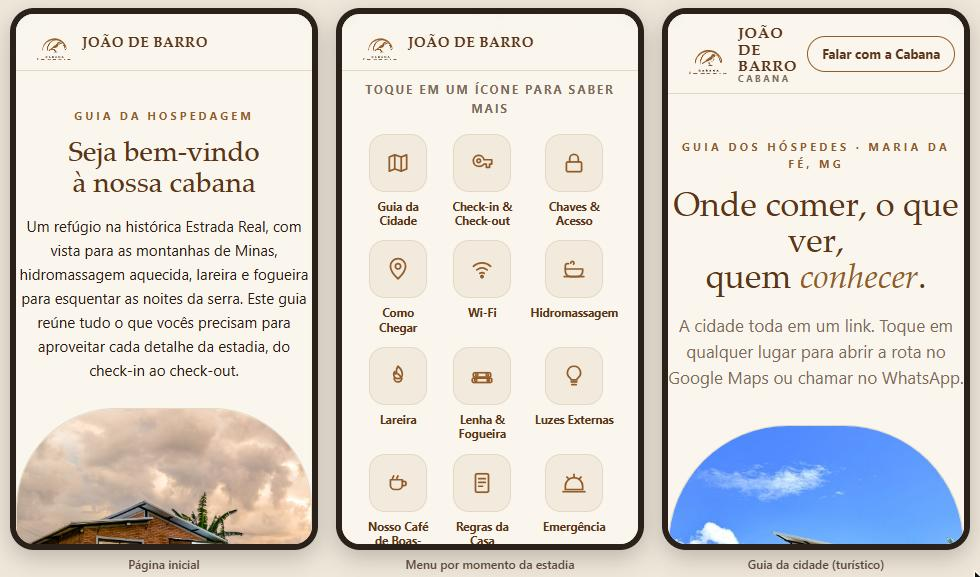
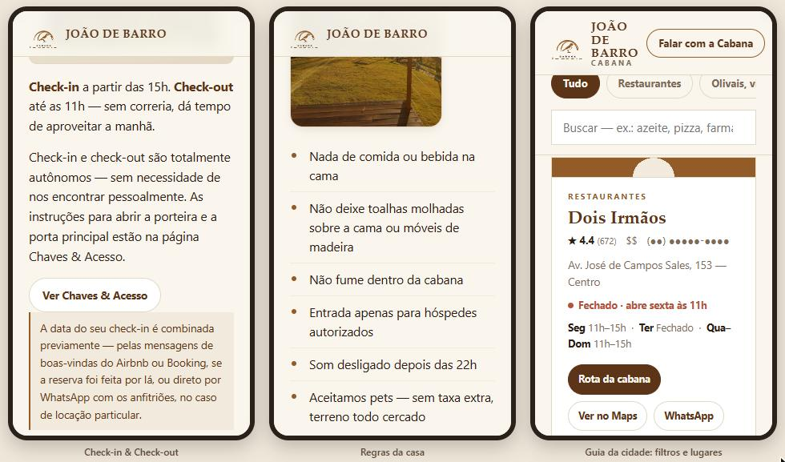

# Cabin Guest App — Cabana João de Barro

Product case: a mobile-first web guide that puts the most relevant, most frequently asked information for a short-term rental stay in one place. Built and in use for a cabin in the Serra da Mantiqueira, Brazil.

**My role:** Product Owner and builder — problem framing, requirements, content curation, AI-assisted development, launch.

> The production guide is shared only with booked guests, by link, and publishes no access codes: lockbox and door codes go in the platform welcome message. This repository documents the product work: the problem, the decisions, the requirements and the prompts that drove the build. Screenshots have sensitive information redacted.

## The problem

Short-term rental guests ask the same basic questions at every stay: how to get there, how to check in, how the house works, where to eat and what to do nearby. The answers lived in scattered platform messages, which meant repetitive work for the host and an inconsistent experience for the guest.

## Users

| User | Need | Moment |
|---|---|---|
| Guest before arrival | Directions, check-in steps, what to bring | Days before the stay |
| Guest during the stay | House rules, how things work, Wi-Fi, who to call | Inside the cabin |
| Guest exploring the region | Restaurants, trails, attractions | During the stay |
| Host | Fewer repetitive messages, one source of truth | Every booking |

## The solution

A curated guide, not an interactive Q&A tool: it gathers the essential information and the answers to the questions guests ask most, organized by moment of the stay. Two connected guides in a single site:

- **Hospitality guide (landing page):** everything needed to arrive and stay well.
- **Tourist guide (one tap away):** a curated guide to the region, linked from the landing page as an icon.

The site is static and hosted on Netlify. It is shared by link in the booking messages and holds no secrets: the lockbox and door codes are sent separately in the platform welcome message, so a forwarded link exposes nothing that opens the property.

## Screens

Phone-width captures of the production guide. The host phone number, the property address and personal names are masked; the access and Wi-Fi pages are not shown.

## Key product decisions

| Decision | Alternative considered | Why |
|---|---|---|
| Content curated from the most frequent guest questions | Exhaustive manual of the house | Guests read what they need, not everything |
| Hospitality guide is the landing page | Tourist guide first | Guests open the link to solve a stay problem; tourism is a secondary job |
| One site, one link | Two separate sites | One link to send in the booking message, with the tourist guide one tap away |
| Access codes kept out of the site, sent in the platform welcome message | Password-protecting the whole site | No hosting cost and no password for guests to manage; a leaked link reveals nothing that opens the property |
| Static HTML, no backend | App builder or CMS | Zero running cost, fast on rural mobile connections, nothing to maintain |
| Mobile-first layout | Desktop-first | Guests read it on their phones, often on the road |

## How I worked with AI

I built the guide with Claude as the engineering copilot. I acted as the Product Owner: I framed the problem, selected and structured the content, wrote requirements and acceptance criteria, and reviewed every iteration against them, rejecting or redirecting output that did not meet the bar.

The [prompts/](prompts/) folder documents that process step by step: the goal of each prompt, what came back, and what I kept or changed and why. Requirements are in [docs/product-brief.md](docs/product-brief.md).

**Stack:** HTML, CSS, vanilla JavaScript · Netlify (hosting).

## How I would measure success

These are the metrics I track or plan to track. No baseline is claimed here.

| Metric | Desired direction | Source |
|---|---|---|
| Repetitive questions per stay | Down | Platform message history |
| Check-in and communication review scores | Up, or stable at the top | Platform reviews |
| Share of guests who open the guide | Up | Site analytics |
| Click-through from landing to tourist guide | Monitor | Site analytics |

## Roadmap

- [ ] English and Portuguese versions
- [ ] One guide per unit as the property grows to new chalets
- [ ] Lightweight analytics events per section
- [ ] Possible next step: an AI assistant that answers guest questions grounded only in the guide content, with handoff to the host

## Repository structure

    README.md            this case study
    docs/                product brief and redacted screenshots
    prompts/             AI prompt log: goal, prompt, output, decision

## Note

Personal project. No access codes, contacts or exact location are published in this repository.
